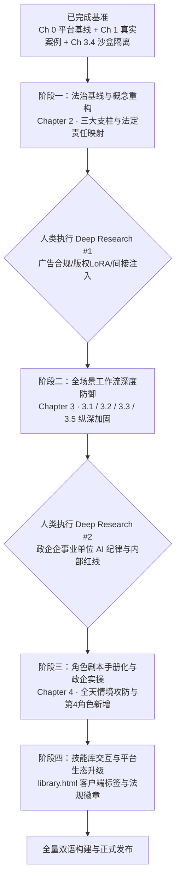

# 《负责任与安全使用 AI 实务指南》全面升级规划总文档 (Master Plan)

> **版本**：v2.0-Roadmap  
> **编制者**：产品经理 (Product Manager)  
> **面向对象**：下一对话的执行 Agent、开源社区协作者及人类审查者  
> **核心原则**：只精选不生造、说话凭实证、对齐法律底线、双轮驱动落地  

---

## 1. 项目愿景与升级背景

本项目（`digitalrightsforall/guide_responsible_AI_use`）致力于帮助以中国知识工作者为代表的普通平民与开发者，建立面对商业大模型和桌面 Agent 的**个人数字自卫防线与交付可信门禁**。

在前期工作中，项目已完成：
- 归档 `v1` 分支（43 个技能基线）；
- 升级至 **44 项真实开源规范技能**（新增微虚拟机隔离 `agent-sandbox-skill`，通过 100% 存活验证）；
- 落地了 **Chapter 0（平台基线与六大留存不等式）** 与 **Chapter 1（中国 AI 声音侵权第一案、最高法 2026 AI 审理意见、Dify/FastGPT 在野 CVE）**。

为了将这份法医级、实证化的标准贯彻到全书，现规划后续 **4 个演进阶段**，并形成标准化执行工单与 Deep Research 需求卡。

---

## 2. 升级路线图与执行次序 (Sequencing Rationale)



### 次序论证：
1. **阶段一（概念与法治基线）先于具体场景**：先在 Chapter 2 确立《个人信息保护法》(PIPL) 与全国网安标委 TC260-005 的法定处理边界，后续所有场景才有统一的法理依据。
2. **阶段二（工作流场景加固）需 Deep Research #1 支撑**：针对虚假广告法处罚、版权侵权与提示词注入实证，需精准补充后写入 3.1、3.2、3.3、3.5。
3. **阶段三（角色剧本）需 Deep Research #2 支撑**：剧本必须是真实企业办公、公文流转、法务审查的真实痛点，依赖真实政企通报与保密红线规范。
4. **阶段四（交互平台与技能库）最后收尾**：在全书场景定稿后，反向提炼数据 Schema 标签（客户端、法规条目），让交互技能库与正文形成丝滑联动。

---

## 3. 各阶段分工与文档索引

| 阶段 | 对应执行文档 | 核心任务 | 是否需 Deep Research | 预期产出与验收核心 |
| :--- | :--- | :--- | :---: | :--- |
| **阶段一** | [`phase-1-legal-and-pillars.md`](file:///Users/gaofeng/Documents/project/skill-4-responsible-AI-use/docs/upgrade_plan/phase-1-legal-and-pillars.md) | Chapter 2 概念重构，映射 PIPL 第6/13/23/28条与 OWASP 框架 | 否（现有资料充足） | 中英长篇指南更新，TOC 联动 |
| **阶段二** | [`phase-2-workflow-deep-defense.md`](file:///Users/gaofeng/Documents/project/skill-4-responsible-AI-use/docs/upgrade_plan/phase-2-workflow-deep-defense.md) | Chapter 3.1, 3.2, 3.3, 3.5 纵深加固（脱敏、查证、防谄媚、四门禁） | **是 (DR #1)** | 填补广告法、知网查验、间接注入实证 |
| **阶段三** | [`phase-3-persona-playbooks.md`](file:///Users/gaofeng/Documents/project/skill-4-responsible-AI-use/docs/upgrade_plan/phase-3-persona-playbooks.md) | Chapter 4 角色剧本手册化，新增第 4 角色“政企与知识工作者” | **是 (DR #2)** | 全天攻防情景剧、SOP 流程化 |
| **阶段四** | [`phase-4-interactive-library-ux.md`](file:///Users/gaofeng/Documents/project/skill-4-responsible-AI-use/docs/upgrade_plan/phase-4-interactive-library-ux.md) | 交互技能库客户端筛选标签、法规条目徽章、Schema 扩展 | 否（纯前端与数据工程） | `items.json` 扩充，`library.html` 交互全通 |

---

## 4. 全局质量门禁与执行纪律 (Execution Rules)

接棒的执行对话与 Agent 必须无条件遵守以下纪律：
1. **单一数据真理源 (Single Source of Truth)**：技能定义以 `site/data/items.json` 为准，双语 README 必须通过 `npm run build` 生成，严禁手写覆盖。
2. **严禁凭空捏造 (Zero Hallucination)**：严禁制造虚假案号、虚构法规编号或捏造假 CVE。若无案号，必须如实注明“官方未披露案号，依最高法公报记载”。
3. **双语完全对齐 (Bilingual Parity)**：`site/js/guide.js` 中的 `guideContent.zh` 与 `guideContent.en` 必须结构、数据与案例 1:1 对齐。
4. **自动化验证循环 (Always Verify)**：每次修改必须执行并通过：
   ```bash
   npm test               # 校验 items.json 格式与数据模式
   npm run test:remote    # 校验全部 44 个远程仓库 HTTP 200
   npm run build          # 重新生成 README.md 与 README_CN.md
   ```
