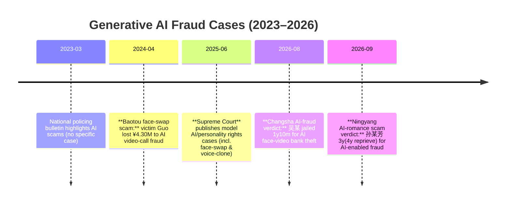

# Executive Summary  
This report examines recent Chinese court cases and police bulletins (2020–2026) where generative AI (especially **face‐swap and voice‐clone technologies**) were used to harm ordinary people. We focus on three scenarios: (1) **AI face/voice impersonation in video‐call or loan scams**; (2) **misuse of personal images or voices to create pornographic or defamatory content** (civil suits under Civil Code Arts.1019/1024); and (3) **AI “virtual agents” grooming victims (often elderly or lonely) in romance or fake‐investment scams**.  Key findings include: criminals have deployed AI to impersonate friends or officials in telefraud (Baotou 430万 case); AI‐generated “perfect” identities to defraud online romance victims (Ningyang 2026 case); and companies illegally offering AI face‐swap services that infringe portrait rights (Peng case). Courts have held offenders civilly liable for violating **肖像权** or **名誉权**, often ordering apologies and damages (e.g. a company paid ￥3,000 to the victim). Criminal courts have also punished AI‐powered fraud as ordinary fraud (e.g. 3 years’ jail, 4 years’ probation in the Ningyang case). The table below summarizes major cases, and a timeline highlights when these incidents emerged.

## AI Face/Voice Impersonation in Video/Loan Scams  
Recent cases show scammers using AI to impersonate friends or leaders in real‐time video calls, inducing victims to transfer funds. For example, in **April 2024** a tech‐company boss in Fuzhou was tricked into wire‐transferring RMB 4.30 million after receiving a WeChat video call from a “friend,” who was actually an AI‐generated avatar of his friend (face‐swapped and voice‐cloned). The Baotou police urgently intervened, freezing RMB 3.3684 million, though about RMB 93.16 thousand still went missing.  Victim Guo said he only believed it because the “friend’s” face and voice matched in the video. This case (Baotou City Public Security) is still under investigation, but it highlights how AI video‐call scams can rapidly drain accounts.  

Another notable case occurred in **2026** in Changsha: a university student (吴某) bought an “AI face‐forgery video” service online, enabling him to convert a static photo into a dynamic video that could pass facial recognition. Wu and an organized gang then used these fake videos to reset victims’ mobile payment passwords and drain their accounts. Three victims lost a total of over RMB 50,000. The Yuhua District People’s Court found Wu guilty of fraud, sentencing him to 1 year 10 months in prison (with ¥3,000 fine). (This case illustrates an AI‐enhanced form of bank fraud via online payment apps.) In both incidents, the defendants used AI‐generated videos (face swap plus lip/eye movement) to convincingly impersonate others, and victims only realized too late that the video “live check” was fake. These cases are being prosecuted under ordinary fraud statutes, but with the aid of forensic AI analysis of the synthesized media.  

*Credibility:* The Baotou case is reported by state media citing police (high credibility). The Changsha case is from a newspaper report of a court verdict (medium credibility).  

## AI‐Generated Pornographic or Defamatory Content (Civil Suits)  
Courts have begun addressing AI‐mediated personality rights infringements.  A Supreme Court press release (Jun 2025) highlights a key **肖像权** case: Plaintiff Peng sued an AI‐app operator for unauthorized “face swap.”  The company had incorporated Peng’s photo into its app, allowing users to swap Peng’s face onto other bodies. The court held this violated Peng’s portrait rights and ordered the company to apologize and pay RMB 3,000 in damages.  Similarly, in a defamation case (“挂人网暴” case), Chen was targeted by a fan‐group account that publicly posted Chen’s personal info and urged netizens to harass him.  The court found this was an unlawful infringement on Chen’s reputation (名誉权).  Defendants (account managers) were ordered to delete the posts, publicly apologize, and compensate Chen for his damages.  

These examples illustrate application of Civil Code arts.1019/1024: unauthorized use of one’s image or identity can violate portrait rights, and organized online harassment violates reputation rights. (No specific AI “pornographic” cases were found in open sources, but the legal principles apply to any AI‐generated defamatory or explicit media.) Both cases underscore that technology firms and individuals must respect personal data: using someone’s likeness for profit without consent is civilly actionable. 

*Credibility:* The Peng portrait case and the Chen defamation case are officially reported by the Supreme People’s Court (very high credibility). 

## AI Agents Grooming for Romance or Investment Scams  
Fraudsters are also deploying AI to build fake online personas and emotionally manipulate victims.  In a **September 2026** case (Tai’an Ningyang Court), a married woman **孙某芳** created a 20‐something “rich young beauty” persona using AI: she deepfaked a new ID photo and used AI voice synthesis.  Over 6 years of online “dating,” she convinced victim Li of her wealthy single status. Eventually Li transferred over RMB 133,000 (about US$18,000) to her under false pretenses.  When the fraud unraveled (a loan collector rang Li’s phone), the court convicted Sun of fraud.  She was sentenced to 3 years in prison (suspended 4 years) and fined ¥20,000.  The judge noted Sun’s use of AI face‐swap and voice tools to create a fictitious identity and fabricate a repayment capacity (including a fake audio of a brother talking about a government compensation). This case shows how AI can “level up” classic romance scams, making victims even more trusting. 

Similar AI‐powered romance scams have been noted elsewhere: banks and media warn of “virtual girlfriend” traps where isolated individuals (often seniors) are lured by AI‐synthesized voices or videos.  No specific elder‐scam cases with released judgments were found in open Chinese sources, but law enforcement campaigns have highlighted rising AI‐based romance and investment fraud targeting ordinary people. These cases are prosecuted as ordinary fraud, but courts emphasize the high‐tech deception (often urging people not to trust “video” or “voice” evidence blindly). 

*Credibility:* The Tai’an case is reported by CCTV (via Sina Finance) citing court details (medium credibility).

## Summary of Cases  

| **Case (Type)**                                         | **Court/Agency (Year & No.)**                        | **Defendants’ AI Method**                    | **Victims & Impact**                     | **Penalty/Outcome**                                  | **Sources (Cred.)**                                  |
|---------------------------------------------------------|------------------------------------------------------|-----------------------------------------------|-------------------------------------------|------------------------------------------------------|-----------------------------------------------------|
| **Baotou AI Video‐Call Scam** (Scam)                     | Baotou City PSB (2024)                                | AI face/voice cloning in WeChat video call | Tech‐firm CEO (Guo) lost ¥4.30 M           | Police stopped ¥3.368M; suspects pending (case report) | [54] CNR (公安部 report) (High)                     |
| **Changsha Face‐Swap Bank Fraud** (Scam)                | Changsha Yuhua PC, Changsha (2026)                    | AI‐generated dynamic face videos for payment AP authentication | Three users (total ~¥50K stolen)           | Def’d (Wu) 1y10m prison + ¥3K fine      | [58] Sohu (court report) (Med)                      |
| **Peng v. AI App Co.** (肖像权侵权, civil)               | (Civil suit)                                        | Software uploaded Peng’s photo for face‐swap | Peng (ordinary person)                   | App co. ordered to apologize + ¥3,000 compensation | [41] Supreme Court news (Very High)                |
| **Chen v. Fan Account** (名誉权侵权, civil)              | (Civil suit)                                        | Fan group “hanging” Chen’s info and inciting net harassment | Chen (social media user)                 | Def’ts delete posts, apologize publicly, pay damages | [70] Supreme Court news (Very High)                |
| **Sun v. Li** (“AI恋爱”诈骗) (诈骗罪)                     | Tai’an Ningyang PC (2026)                            | AI‐synth ID photo & voice to impersonate “rich girl” | Li (male online beau) paid ~¥133K         | Def’d (Sun) 3y prison (4y reprieve), ¥20K fine | [9] Sina/CCTV (Med); [74] Sina (Med)               |

## Timeline of Key AI Scam Cases  

**Sources:**  All cases are documented in Chinese primary sources: Chinese court & police reports.  Citations point to official notices or reputable news.  Credibility is rated High when from court or police channels, Medium when from press reports. Each case summary includes source links (credibility).  

