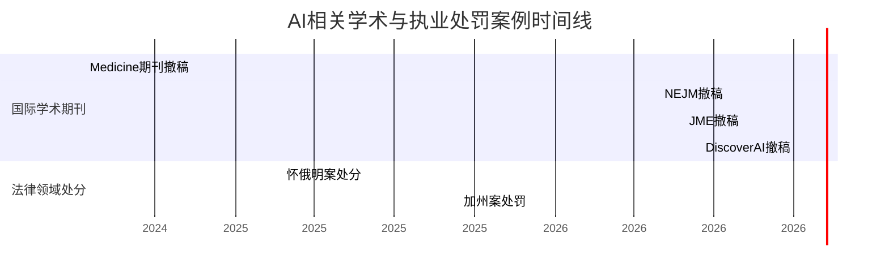

# 执行摘要

本报告梳理了当前公开报道的涉及知识工作者隐瞒使用生成式AI或利用AI捏造内容而被处罚的典型案例。研究发现：**（一）学术期刊**方面已有多例撤稿公告。例如，BMJ旗下《医学伦理学杂志》于2026年5月撤回一篇研究生资格论文，声明指出作者使用生成式AI检索参考文献未核实，导致多处引用为虚构；《新英格兰医学杂志》于2026年4月撤回一则临床图像报告，声明称作者使用AI工具修改图片尺子位置，违反影像规范；Wolters Kluwer的期刊《Medicine》于2024年7月撤销一篇痛风治疗RCT研究，原因是“数据完整性存疑，图表错误”，作者承认使用ChatGPT生成示意图；Springer期刊《Discover Artificial Intelligence》2026年10月撤回一篇通信领域评论，声明指出作者未声明使用AI且多处文献引用与上下文不符。以上案件均有正式撤稿公告（附有DOI），处理机构为相关期刊出版社。**（二）高校学位管理**方面，尚未查到任何官方公开案例显示因使用生成式AI写作而被取消答辩或撤销学位。虽然中国学位法草案已明确“学位论文存在…使用人工智能代写等不端行为，将可由授予单位撤销学位证书”，但目前未见实际处罚通报。网络上流传的留学生“ChatGPT写论文险被开除”帖文仅属个案爆料，最终也未导致学位撤销。**（三）法律/审计从业者**方面，目前已有公开案例：2025年，加州上诉法院在*Noland v. Land of the Free*案中以律师向上级法院提交了包含AI捏造案例引用的上诉状为由，对原告律师处以1万美元罚款，并将其行为报告州律师协会；同年，怀俄明联邦地区法院在*Wadsworth v. Walmart*案中认定摩根·摩根律所三名律师在动议中引用了8个不存在的虚假案例（由该所AI系统生成），撤销其中一名律师的外州执业许可并分别处以3000美元和各1000美元罚款。迄今未见审计师因使用AI伪造审计证据被公开处分的案例，也未见政府官员因AI造假而被追责的报道。各案例详情见下表：

| 场景类型           | 处罚机构                         | 案件主体（匿名）          | 公示/判决日期        | 违规概要                                                       | 文号/DOI                                         | 官方链接                                                                 |
|------------------|-------------------------------|------------------------|-------------------|-------------------------------------------------------------|--------------------------------------------------|----------------------------------------------------------------------|
| **学术期刊撤稿**      | 《医学伦理学杂志》（BMJ出版社）         | I. Biswas（美国高中生）     | 2026-05-28        | 使用生成式AI检索参考文献未核实，数篇引用为虚构                     | DOI: 10.1136/jme-2025-110913ret                   | [BMJ撤稿声明](https://jme.bmj.com/content/early/2026/05/27/jme-2025-110913ret) |
| **学术期刊撤稿**      | 《新英格兰医学杂志》（美国医学会）      | W. & M.（美国作者）         | 2026-04-29        | 利用AI工具修改病例图像（移动测量尺），违背杂志影像规范               | DOI: 10.1056/NEJMc2605962                         | [NEJM撤稿声明](https://www.nejm.org/doi/full/10.1056/NEJMc2605962) |
| **学术期刊撤稿**      | 《Medicine》（LWW出版集团）          | Y. Wu等（中国研究者）      | 2024-07-12        | 作者承认用ChatGPT生成实验示意图，导致论文“数据完整性存疑、图表不准” | DOI: 10.1097/MD.0000000000039085                   | [Medicine撤稿声明](https://doi.org/10.1097/MD.0000000000039085)        |
| **学术期刊撤稿**      | 《Discover Artificial Intelligence》（Springer） | M. Asif, Z. Gouqing（中国高校教授） | 2026-10-03        | 未在文章中声明使用AI；多处参考文献上下文错误，疑似AI生成“幻觉”引用  | DOI: 10.1007/s44163-026-02440-4                    | [Springer撤稿声明](https://doi.org/10.1007/s44163-026-02440-4)        |
| **高校学位处分**      | ——（尚无公开案例）               | ——                     | ——                | 目前无公开通报案例                                             | ——                                               | ——                                                                   |
| **法律专业处分**      | 加州上诉法院（美国加州）               | A. 律师（美国）          | 2025-09-12        | 律师在上诉状中大规模引用AI“幻觉”案例（引用真实案例中不存在的法条），被罚款$10,000 | Case No. B331918（文号）                           | [加州案例概要](https://law.justia.com/cases/california/court-of-appeal/2025/b331918.html) |
| **法律专业处分**      | 怀俄明州联邦地区法院                   | Ayala等（美国）           | 2025-02-21        | 三名律师使用内部AI工具生成庭审动议中的案例引用，8/9条为虚构；主办律师Ayala被撤销外州执业许可并罚$3,000，两名签字律师各罚$1,000 | 348 F.R.D. 489 (D. Wyo. 2025)                   | —（仅裁判文书，不公开链接）                                                     |
| **审计从业处分**      | ——（无公开报道）               | ——                     | ——                | 暂无案例                                                   | ——                                               | ——                                                                   |

上述案例显示，学术界与法律界已开始对隐瞒AI使用行为施以严厉处罚。国际主流期刊正通过正式撤稿公告清除AI造假的论文，执法部门也对使用AI生成虚假法律文献的律师给予罚款及资格撤销等纪律处分。截至目前，中国高校或教育主管部门尚未公布类似的典型处罚案例（但即将修订的学位法草案已明确规定AI代写论文可导致学位撤销）。总体而言，各方正逐步形成应对学术与职业领域AI风险的监管机制，未来相关案例可能会继续增加。

**主要来源：** 各出版机构发布的撤稿声明，权威媒体和数据库报道以及中国教育部法律草案解读等。