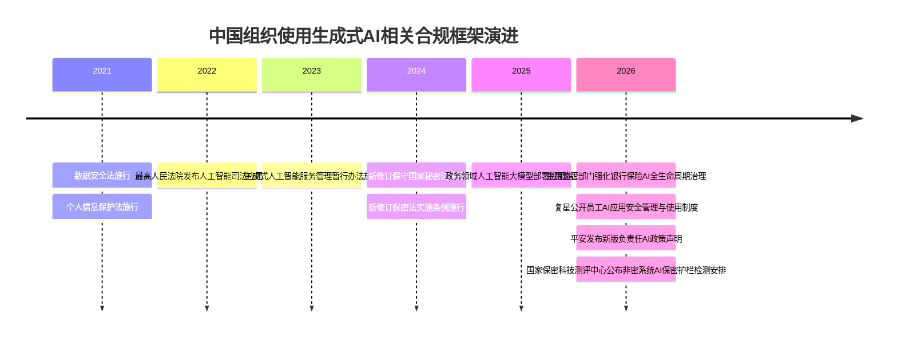
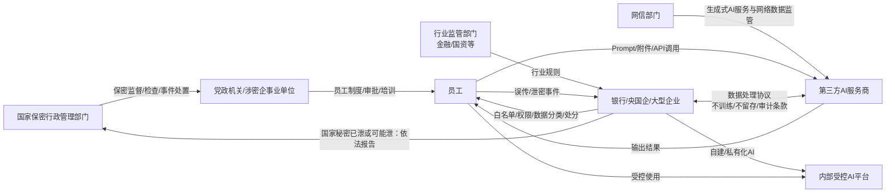
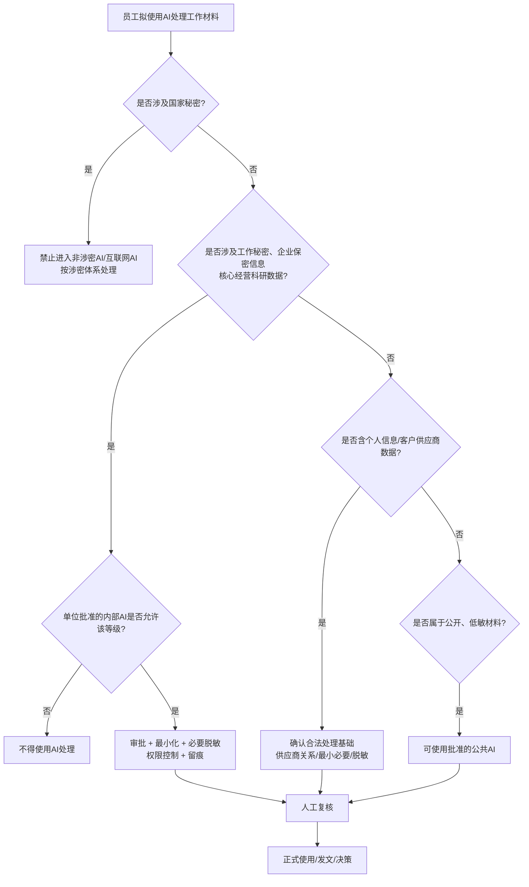

# 中国组织员工使用生成式 AI 的保密管理、公文纪律、数据合规与内部处分：公开证据调研报告

## 执行摘要

截至2026年10月2日，公开证据显示：中国并不存在“一律禁止员工使用生成式AI”的统一规则，但**国家秘密输入非涉密/互联网AI属于明确红线**；工作秘密、企业保密信息、个人信息及核心经营数据则进入“分类分级、审批、脱敏、最小必要、人工复核、留痕审计”框架。近年官方已通报多起因AI写作、开源AI分析、云端图文识别导致涉密信息暴露或外流的事件，责任人员受到严肃处理、政务处分或解除劳动合同。公开企业制度中，复星、中国石油的员工使用规则最具可操作性；银行、互联网大厂公开材料更多停留在治理原则或自建平台层面，真正的员工白名单、DLP和处分细则通常不公开。citeturn25search0turn15view5turn23view1turn26view0turn18view0

## 方法与数据来源清单

本报告以**截至2026年10月2日可公开检索和交叉核实的资料**为研究边界，优先近五年材料；对于法律法规，则保留现行基础性法律。证据优先级依次为国家法律法规及中央监管部门、国家及地方保密/网信机关、企业官方网站公开制度、新华社等主流媒体、党政机关转载的案例教育材料。对于自媒体所称“某大厂内部AI规定”、聊天截图、匿名员工爆料等，若无法找到企业官网、监管机关或主流媒体独立印证，不作为企业制度事实依据。

| 证据层级 | 主要资料 | 本报告用途 |
|---|---|---|
| A：法律及中央监管原文 | 《保守国家秘密法》及实施条例、《数据安全法》《个人信息保护法》《生成式人工智能服务管理暂行办法》、政务大模型指引等 citeturn25search0turn25search1turn8search2turn9search9turn25search2turn15view5 | 判断禁止事项、数据处理义务、报告和责任边界 |
| B：保密机关、地方政府公开通报 | 国家保密局、吉林省国家保密局、安徽省国家保密局等 citeturn24view2turn23view1turn4search5 | 识别真实违规模式和实际执法/纪律风险 |
| C：企业官方公开制度 | 复星《负责任AI应用安全管理与使用制度》、中国石油《负责任人工智能（AI）政策》、平安集团Responsible AI Policy等 citeturn26view0turn18view0turn26view1 | 比较员工使用、外部模型、分类分级和审计要求 |
| D：官方战略/平台材料 | 工商银行“工银智涌”、交通银行AI规划、腾讯Responsible AI、阿里AI Governance citeturn2search1turn2search0turn20search1turn20search0 | 判断大型机构正在采取的受控内部平台路线，但不把其误当成员工手册 |
| E：主流媒体核验 | 新华社有关国家机关工作人员违规使用开源AI案例 citeturn23view4 | 补充案例事实链 |

**案例编码规则。** 官方只披露“某单位”“李某”“某AI写作应用”的，本报告不尝试反向识别单位、人员或模型；同一事实被多个地方保密机关转发时去重；事发日期未公布的，以“公开通报日期”标识，而不虚构事件发生时间。所谓“处分结果”严格区分“严肃处理”“行政警告”“解除劳动合同”“依法处分”等不同表述，不把“严肃处理”擅自解释为开除、记过或刑事处罚。citeturn23view1turn23view3

**假设：**用户所称“微信AI助手”包括微信内嵌、小程序或经微信入口调用的第三方云端智能处理服务。若某功能完全本地、离线运行，其数据外传风险会不同；因此本报告重点分析网页、App、API、小程序等存在第三方处理链路的办公场景。

一个重要的负面发现是：**在本次能够以官方或主流媒体核验的真实泄密案例中，没有足够证据把具体事件归因于ChatGPT、Kimi、豆包、DeepSeek或某一款微信AI助手。**公开通报通常只写“AI写作应用”“流行的开源AI工具”等。把匿名案例直接改写成“员工向ChatGPT/DeepSeek泄密”是不严谨的。citeturn23view1turn23view3turn23view4

## 真实案例与纪律红线

下表把生成式AI事件和一个高度相关的“云端OCR/微信”事件分别标识。后者不是生成式AI，但在合规机理上极有价值：**只要把敏感材料交给未经批准的互联网第三方处理，工具究竟叫OCR、AI助手还是大模型，并不会改变“信息已离开受控环境”的核心风险。**citeturn23view3turn24view2

| 时间 | 单位 | 事件摘要 | AI工具 | 泄露信息类型 | 处分/后果 | 来源链接 |
|---|---|---|---|---|---|---|
| 通报最迟见于2025-04-24；事发时间未披露 | 某涉密单位 | 工作人员李某起草涉密方案，为让AI代写，将方案部分敏感内容输入手机AI写作应用并生成网络文件 | AI写作应用，品牌未披露 | 涉密方案的部分敏感内容 | 李某“受到严肃处理”；具体处分种类未公开 | 安徽省国家保密局；后由吉林省国家保密局等转载核实 citeturn4search5turn23view1 |
| 通报最迟见于2025-04-24；事发时间未披露 | 某科研机构 | 研究人员为快速完成报告，将部分核心数据和实验成果上传至AI写作应用，导致报告中部分涉密敏感信息泄露并在网上流传 | AI写作应用，品牌未披露 | 核心数据、实验成果及研究报告中的涉密敏感信息 | 造成经济损失并损害国家利益；研究人员“受到严肃处理” | 安徽省、吉林省保密部门公开案例 citeturn4search5turn23view1 |
| 2026-04-14公开报道；事发时间未披露 | 某国家机关 | 工作人员“小王”未经安全评估及审批，使用流行的开源AI工具分析内部文件；电脑默认公网可访问且未设密码，最终被境外IP访问、下载 | 开源AI工具，产品名未披露 | 内部敏感资料、涉密资料 | 泄密已实际发生并损害国家安全；新华社公开报道未说明处分等级，其他政府网站转载材料称有关责任主体受到处分 | 新华社；吉林省国家保密局 citeturn23view4turn23view1 |
| 2026-04-07公开 | 某涉密单位 | 某次涉密会议筹备中，工作人员冯某把敏感内容改成字母代码后再输入AI写作工具，希望规避泄密风险 | AI写作工具，品牌未披露 | 涉密会议材料 | “涉密信息暴露风险陡增”，冯某受到严肃处理；公开材料未称已造成实际对外泄密 | 七一网转载“保密观”案例 citeturn23view3 |
| 2026-04-07公开；**非生成式AI邻接案例** | 某重大活动保障单位及第三方人员 | 机密级安保方案被手机拍摄，用图文识别小程序转为Word，再经微信传输助手传送，造成泄密 | OCR小程序＋微信传输助手 | **机密级**安保工作方案 | 单位副职领导王某被行政警告；两名第三方服务人员被解除劳动合同 | 七一网转载“保密观” citeturn23view3 |

这些案例暴露出几个非常稳定的纪律红线。

**第一，国家秘密不是“脱敏一下就能上传”。**《保守国家秘密法》明确禁止使用非涉密信息系统、非涉密信息设备存储或处理国家秘密，也禁止未经规定的保密措施在互联网等公共信息网络中传递国家秘密；违法可依法给予处分，重大泄密案件还要追究直接主管人员及其他直接责任人员。法律同时要求对“汇聚、关联后属于国家秘密事项”的数据加强管理。citeturn25search0

冯某案例特别重要：把姓名、地名或敏感词换成字母代码，只是非常弱的**假名化/遮盖**，并不会自动改变原材料的涉密性质。吉林省国家保密局的公开警示也明确反对“分段输入”“代码替换”“删除对话即可安全”等侥幸认识，并要求公共AI处理非涉密内部工作信息时，输入和输出中不应存在可溯源、可识别的内部敏感要素。citeturn23view1

**第二，“境内部署”“国产大模型”不等于可以处理秘密。**政务大模型指引要求防止国家秘密、工作秘密和敏感信息输入**非涉密人工智能大模型**；换言之，判断标准首先是系统是否经过相应涉密体系建设和管理，而不是模型品牌或国别。普通网页端Kimi、豆包、DeepSeek等，即使服务商位于境内，也不能因此获得处理国家秘密的资格。citeturn15view5turn25search0

**第三，公职人员面临的是“单位纪律＋政务处分＋党纪＋刑事风险”的叠加体系。**《公职人员政务处分法》第三十九条将泄露国家秘密、工作秘密，或者因履职掌握的商业秘密、个人隐私列为处分事项；造成不良后果或影响的，可依情节从警告、记过、记大过，直至降级、撤职、开除。党员泄露干部选拔、纪律审查、巡视巡察等尚未公开事项或其他应当保密内容的，还可能受到党纪处分。citeturn24view1turn21search6

国家秘密泄露达到刑事标准时风险进一步上升。《刑法》第三百九十八条规定，国家机关工作人员故意或者过失泄露国家秘密、情节严重的，可以构成相应泄密犯罪；《保守国家秘密法》本身也规定构成犯罪的依法追究刑责。citeturn21search11turn25search0

**第四，普通企业员工并不适用“政务处分”体系，但绝非没有处分依据。**企业通常依据依法制定并公示的员工手册、信息安全制度、保密协议、AI使用制度实施警告、内部处分或劳动关系处理。《劳动合同法》第四条要求直接涉及劳动纪律等切身利益的规章制度履行相应制定、公示程序；第三十九条允许在劳动者严重违反用人单位规章制度、严重失职并给单位造成重大损害等情况下解除劳动合同，第九十条还规定违反约定的保密义务给单位造成损失的，可承担赔偿责任。citeturn22search1turn22search2

这也是为什么企业AI规则是否**明确写进员工制度、是否培训和公示、是否定义信息分类和违纪等级**非常重要：只有“领导口头说不准用AI”而缺乏正式制度、边界和证据链，在劳动争议中的可执行性显著弱于经过合规制定和告知的制度。该结论是依据劳动合同法与公开企业制度作出的制度性推论。citeturn22search1turn26view0

## 政策与通告要点汇总

公开政策正在形成一个很清楚的分层逻辑：**国家秘密实行硬隔离；工作秘密和内部敏感信息实行受控处理；普通公开信息可以提高AI利用率。**

| 发布主体/时间 | 公开规则或警示 | 对员工日常办公的实际含义 |
|---|---|---|
| 全国人大，2024年修订《保守国家秘密法》 | 非涉密信息系统、设备不得存储或处理国家秘密；汇聚关联后形成国家秘密的数据同样要管控；违规可处分乃至追究刑责 citeturn25search0 | 网页AI、普通App、普通企业AI门户均不能成为国家秘密“临时加工站”；复制一个段落也不因信息量少而当然安全 |
| 国务院，2024年修订实施条例 | 泄密或可能泄密应立即补救，并在**24小时内**向同级保密行政管理部门和上级主管部门报告；工作秘密也须采取技术、自监管等保护措施，严重泄露可处分责任人员 citeturn25search1 | 发生误传AI后不能只“删聊天”；必须进入正式事件响应和报告流程 |
| 国家保密科技测评中心，2024 | 在线办公应坚持“上网不涉密、涉密不上网”，不得通过微信、邮箱、云盘等互联网途径存储处理传输国家秘密、工作秘密 citeturn24view2 | AI只是互联网第三方处理工具的新形态，既有网络办公保密纪律仍直接适用 |
| 安徽省国家保密局，2025 | 以AI写作泄密真实案例开展警示，强调涉密文件、图片、音视频等不得交给生成式AI处理 citeturn4search5 | 禁止对象不限于“整份公文”，截图、附件、表格、实验数据也属于风险输入 |
| 国家网信办、国家发改委，2025《政务领域人工智能大模型部署应用指引》 | 允许AI用于辅助文书起草、资料检索、辅助评审等，但要求全周期管理、辅助型定位、输入输出内容管控、运行日志及定期审计，并防止国家秘密、工作秘密、敏感信息进入非涉密模型 citeturn15view5 | **不是禁止AI写公文，而是禁止不受控地用互联网AI写公文**；系统、数据和人工审核必须一起管 |
| 吉林省国家保密局，2026 | 要求互联网大模型不得处理国家秘密；机关单位使用AI开展工作应执行“先审批、后使用”；确需公共AI处理非涉密内部信息时先全面脱敏；发现泄密要保留记录并及时上报 citeturn23view1 | 可作为机关单位员工操作层最清晰的公开范式：审批、脱敏、留痕、报告 |
| 国家保密科技测评中心，2026-09 | 已制定印发“非密信息系统人工智能大模型保密护栏”相关国家保密标准，计划自2026-12-15开始产品检测受理 citeturn24view3 | 监管正在从单纯教育性“禁传”进一步转向技术护栏、检测认证和机器化拦截 |

值得特别澄清《生成式人工智能服务管理暂行办法》的边界。该办法主要规范向境内公众提供生成内容的服务；企业、科研机构等自行研发应用而**未向公众提供服务**的，第二条明确不适用该办法。但这绝不意味着企业内部AI可以不受监管：《数据安全法》《个人信息保护法》《保守国家秘密法》、行业监管和企业内部制度仍然有效。citeturn25search2turn8search2turn9search9turn25search0

个人信息方面，员工把客户名单、身份证号、员工档案等输入第三方AI，不能只视为“我跟机器人聊了一句”。从数据治理角度，这是组织数据被第三方系统处理的行为。《个人信息保护法》对委托处理要求明确约定处理目的、期限、方式、个人信息种类、保护措施并对受托方进行监督；敏感个人信息还受到更严格条件约束。因此，由员工自行注册消费级网页AI并上传单位个人信息，通常很难满足组织对受托处理方的合同、监督和最小必要控制要求。这是依据法律条款作出的合规推论。citeturn9search9

《数据安全法》采用更广泛的数据处理概念，并要求分类分级、风险监测和事件处置；国家机关委托他人建设维护电子政务系统、存储加工政务数据时，还必须经过严格批准并监督受托方，受托方不得擅自留存、使用、泄露或向他人提供政务数据。员工绕过统一采购和审批直接把政务数据投向公共AI，与这一受控委托逻辑明显冲突。citeturn8search2

**政策与制度演进时间线：**

其中，2021年的《数据安全法》和《个人信息保护法》分别构成数据安全、个人信息处理的基础制度；2023年《生成式人工智能服务管理暂行办法》于8月15日施行；新《保守国家秘密法》于2024年5月1日施行，新实施条例于2024年9月1日施行；政务AI专项指引于2025年10月发布；2026年监管和企业制度开始明显进入“可审计、可追溯、技术护栏化”阶段。citeturn8search2turn9search9turn25search2turn25search0turn25search1turn15view5turn24view3

**典型责任关系可以抽象为：**

这一关系意味着，员工与AI之间看似简单的“网页聊天”实际上横跨**员工责任、单位数据控制者责任、AI供应商责任和监管责任**。复星已经把供应商“不使用集团数据训练通用模型”、数据处理留存限制和审计条款直接写入公开制度；政务指引也要求安全责任、权限、日志和事件报告形成完整链条。citeturn26view0turn15view5turn25search1

## 企业内部主流管理规约

公开证据最大的特点是**透明度极不均衡**。复星公开的是接近完整的员工操作制度；中国石油公开了相当具体的集团政策；平安公开集团AI治理要求；工商银行、交通银行更多公开受控内部平台和模型治理体系；腾讯、阿里公开的是AI治理原则，而不是员工上班时究竟能不能把会议纪要复制到某个网页模型的操作手册。因此，下表明确区分“员工制度”和“治理原则”，避免把两者混为一谈。

| 类型/机构 | 公开制度证据 | 外部/公共AI使用边界 | 会议纪要、招标、绩效材料如何处理 | 脱敏与人工复核 | 留痕、审计和责任 |
|---|---|---|---|---|---|
| **党政机关基线** | 2025政务大模型指引＋保密法规 citeturn15view5turn25search0 | 国家秘密、工作秘密、敏感信息不得输入非涉密AI；原则上通过统一、受控政务模型开展应用 | 涉密会议纪要直接禁止进公共AI；非涉密内部材料依审批、数据分类处理。公开中央文件未逐项点名“招标/绩效” | AI仅辅助；公开服务需内容审核；地方保密规则要求公共AI处理非涉密内部资料前全面脱敏 citeturn23view1 | 用户身份与权限、运行日志、定期审计、应急报告 |
| **复星集团** | 《负责任AI应用安全管理与使用制度》IT_011_V1.1，2026-08-27；适用于集团部门、员工及可接触信息资产的外部人员 citeturn26view0 | 员工优先使用集团AI；公共AI只能使用集团推荐应用；**公共AI禁止输入集团任何保密信息**，不得擅自输入个人/敏感个人信息 citeturn26view0 | 原文未点名三种材料，但只要会议纪要、招标文件、绩效材料属于非公开经营/技术/他人保密信息，即进入“保密信息”规则；不能因文档名称变化规避 | 集团AI中秘密级信息须审批授权、脱敏后方可输入；机密及以上信息禁止员工直接输入。关键决策必须HITL、可人工推翻 citeturn26view0 | 可为保密、审计、安全目的进行管理、监测、取证；建立访问日志；人工干预过程须留书面或电子记录；违反制度可处罚、追偿，严重者移送司法 citeturn26view0 |
| **中国石油天然气股份有限公司** | 官方《负责任人工智能（AI）政策》 citeturn18view0turn19view1 | 未经合法授权或合规审查，不得把个人信息、敏感信息、商业秘密、重要生产经营信息等输入未经批准的外部AI、第三方模型或服务 citeturn18view0 | 未逐项点名会议纪要/招标/绩效；但员工管理、供应商管理、重大经营决策等明确属于审慎应用场景，因此相关底稿原则上按其数据性质控制 | 重大经营、财务、法律、HSE等坚持“人类主导决策、AI辅助支持”；员工管理等权益场景要求必要的人工复核 citeturn18view0turn19view1 | 要求标识、过程记录、日志留痕，并合理记录模型来源、适用场景、关键输入输出及人工审核；实行“谁主管谁负责、谁使用谁负责”，违规依规依纪追责 citeturn18view0 |
| **平安集团** | 2026年9月《Policy Statement on Responsible AI of Ping An Group》 citeturn26view1 | 公开文本强调数据边界、个人信息保护和敏感权限审批，但未公开普通员工可用公共AI白名单/黑名单 | 未公开会议纪要、招标或绩效材料的员工输入细则 | 高风险AI须申报、审批、监督；关键决策保留有效人类控制；个人信息实行最小必要、敏感个人信息更严格保护 citeturn26view1 | 高风险AI须可追踪、可验证，并接受内部审计、独立验证和监管检查；AI安全治理进入全员AI培训核心模块 citeturn26view1 |
| **银行保险业监管基线** | 国家金融监督管理总局2026年银行保险业AI安全开发应用指导意见 citeturn13search1turn25search3 | 强调第三方模型内部评估、外包/供应链管理及AI全生命周期控制 | 具体机构应按业务、数据风险和模型用途实施分级；并非允许员工任意调用消费级AI | 高风险事项要求人的监督、风险评估及验证 | 强调生命周期管理、责任可追溯和安全监测；成为银行内部AI制度的监管底板 citeturn13search1 |
| **工商银行** | 官方披露“工银智涌”大模型技术金融应用平台，覆盖大量业务线和场景，包括尽调、授信、反洗钱及智能办公 citeturn2search1 | 对外公开信息体现的是**把AI能力纳入银行自有受控平台**，未公开员工使用ChatGPT/Kimi等的具体白名单 | 可确认内部AI已进入报告生成、办公辅助；但未见公开员工资料分类条款 | 具体操作规则未公开 | 平台化治理明确，但输入限制、日志保存期、违规处分细则未公开 |
| **交通银行** | 官方AI规划提出统一AI能力平台、模型治理体系及场景/技术准入，并覆盖智能办公 citeturn2search0 | 体现“统一平台＋准入”路线；未见公开的消费级AI员工规约 | 公开规划不含会议纪要/招标/绩效专门规则 | 模型治理和场景准入公开，员工脱敏细则未公开 | 内部模型治理体系公开，具体员工审计日志规则未披露 |
| **腾讯** | 官方Responsible AI Principles明确隐私、数据安全、风险识别及“安全红线”治理 citeturn20search1 | **没有找到经腾讯官网公开的员工网页AI输入分类手册** | 无公开可核实条款允许据此判断会议纪要/招标/绩效的具体处理方式 | 公司层面强调全生命周期风险识别和安全防护 | 公开的是治理原则，不应被误写为员工处罚制度 |
| **阿里巴巴** | 官方AI Governance披露模型全生命周期治理、安全评测及高风险场景的人类监督要求 citeturn20search0 | 未发现官方公开的集团员工ChatGPT/Qwen等使用白名单和公司文档输入分级制度 | 无公开证据支持具体到三类文件 | 高风险决策强调专业人员审查 | 可确认模型治理体系，不能据此推断阿里员工内部处分细则 |

公开企业制度中，**复星的规则最接近成熟的“企业版AI可接受使用政策”**：它既区分“集团AI”和“公共AI”，又区分部署权限与普通员工使用权限；外部模型需要安全、法律审核以及数据不落地、训练使用限制、审计等合同控制；员工使用公共AI时任何集团保密信息都不得输入，使用集团AI时秘密级信息也需要审批和脱敏；集团还保留在合法范围内监测、取证和处置AI资产的权力。citeturn26view0

这一点很值得注意：复星的**“系统是否具备技术处理能力”**与**“普通员工是否有权输入该级别数据”**不是一回事。例如部署规则允许在特定批准条件下由特定内部环境处理较高等级企业数据，但员工使用章节仍设置更严格的输入禁区。企业不应把“我们部署了私有模型”误解为“所有员工现在都可以把所有内部资料扔进去”。citeturn26view0

中国石油则代表央企体系中另一种较成熟模式：不简单用“是否国产”判断，而是同时看**业务属性、数据敏感度、影响范围和风险等级**；未经授权或合规审查，受保护数据不能进入未经批准的外部模型，并明确记录关键输入输出和人工审核情况、实行“谁主管谁负责、谁使用谁负责”。citeturn18view0turn19view1

基于这些公开制度，可以归纳出一套**“红—黄—绿灯”模型**。以下是本研究的综合归纳，并非声称所有机构都使用这一名称：

| 等级 | 典型数据/场景 | 建议处理 |
|---|---|---|
| **红灯：禁止进入公共AI** | 国家秘密；工作秘密；涉密会议材料；尚未公开且被单位定为保密的经营、技术、投融资、并购、报价、核心科研数据；密码、密钥、生产控制参数等 | 国家秘密严格执行涉密体系；其他单位高敏数据原则上仅在经批准的内部环境按权限处理。不得靠换人名、分段、字母代码来“洗白” |
| **黄灯：条件使用** | 普通内部会议纪要、未公开招标/采购材料、员工绩效底稿、客户/供应商资料、一般个人信息、非公开业务分析 | 原则使用企业批准的内部模型；必要时事前审批、数据最小化、去标识/脱敏、权限控制、人工复核和审计留痕；是否可进入外部AI由制度与合同决定 |
| **绿灯：受控开放** | 已公开政策、公开新闻、公开产品资料、员工自行创作且无单位秘密/个人信息的普通文本 | 可使用批准的公共AI，但仍需注意知识产权、错误信息、生成内容标识和最终人工责任 |

这一区分符合保密法、政务指引及复星、中国石油公开制度的共同方向。citeturn25search0turn15view5turn26view0turn18view0

由此也可以提炼为企业员工手册中的**“三不准”模板**：

**不准绕过批准工具。**不得自行注册网页AI、浏览器插件、智能体、微信小程序或外部API来处理单位内部资料；工具准入本身应有供应商和安全评估。该原则直接对应吉林“先审批、后使用”、复星外部模型审核和交通银行场景/技术准入机制。citeturn23view1turn26view0turn2search0

**不准把受保护数据投喂公共模型。**尤其是国家秘密、工作秘密、企业保密信息、核心科研经营数据，以及无合法处理基础的个人信息。是否是DeepSeek、Kimi、ChatGPT、豆包并不是核心判断变量；真正的判断变量是**数据是什么、模型环境是什么、供应商是否获批、数据是否会被留存/训练/跨境、单位有没有控制能力**。citeturn25search0turn15view5turn26view0turn18view0

**不准把未经人工复核的AI输出直接当作正式结论。**政务大模型被定位为辅助工具；中国石油重大经营、财务、合规、法律及安全事项坚持人类主导；复星关键决策要求HITL并保留人工干预记录；平安高风险应用也要求有效人类控制。citeturn15view5turn18view0turn26view0turn26view1

对于用户特别提出的三类日常材料，公开证据支持以下更精确的处理方式：

**会议纪要。**“会议纪要”这个文件名本身不决定密级。涉密会议纪要属于红灯，不能进入普通网页AI；包含尚未公开政策、干部、人事、重大项目等工作秘密的，同样不宜进入公共AI。普通内部会议纪要如确需公共AI辅助整理，应先确认单位制度允许，再删除姓名、联系方式、项目代号、金额、客户、决策意见等可识别信息；而涉密材料不能靠这种“脱敏”自行变成可上网材料。citeturn25search0turn23view1turn23view3

**招标/采购材料。**现有公开制度没有全国统一规则认定“所有招标文件都是秘密”；应看具体内容和阶段。不过未公开底价、采购计划、供应商报价、技术方案、评分意见、合同谈判信息等往往属于单位非公开信息甚至商业秘密，因此最安全的默认级别应是黄灯或红灯，而不是因为文档没有“秘密”二字就可以上传。复星对“任何保密信息不得进入公共AI”、中国石油对商业秘密和重要生产经营信息不得进入未经批准外部AI的规则，都直接覆盖这种风险。citeturn26view0turn18view0

**绩效材料。**绩效评价通常包含可识别员工的个人信息，但“绩效评分”本身并不自动等于《个人信息保护法》列举的敏感个人信息；若同时含工资、金融账户、医疗健康、身份资料等，则可能进入更高保护等级。中国石油明确将“员工管理”列为可能影响利益相关方权益、需审慎使用和必要人工复核的AI场景；复星则对公共AI输入个人及敏感个人信息设置严格条件。citeturn9search9turn18view0turn26view0

## 关键发现与合规建议

**最重要的实证结论不是“某个模型危险”，而是“Shadow AI（未经批准的员工自行用AI）危险”。**目前公开的严重事件共同具有类似结构：员工追求效率 → 绕过单位安全评估或把受控资料带出受控系统 → 第三方云端/公网成为新的数据处理节点 → 数据留存、暴露或攻击面失去组织控制。李某、科研人员、小王以及OCR小程序案例都符合这一结构。citeturn23view1turn23view3turn23view4

**“禁用所有AI”不是长期可持续的治理模式，成熟方向是“批准工具＋分类数据＋技术护栏＋人工责任”。**中央政务指引一方面明确允许辅助文书、资料检索、评审等AI场景，另一方面要求统一部署、权限、日志、内容安全和保密护栏；国家保密科技测评中心已经发布非密信息系统AI保密护栏产品检测安排。这表明政策正在从单纯靠员工记忆保密纪律，向机器化发现和阻断敏感输入演进。citeturn15view5turn24view3

**企业建议：建立“AI网关而非AI禁令”。**对于大型组织，可将员工允许使用的公网模型通过企业网关、API代理或企业账号统一接入，实施SSO、部门和岗位权限、模型白名单、数据分类识别、敏感提示拦截、附件扫描、调用额度、供应商路由及审计。国家秘密仍应完全留在符合涉密要求的环境之外，不能由“保密护栏”代替涉密系统。该架构与政务指引的统一管理、复星统一身份认证和内容安全引擎、央企私有/受控AI路线一致。citeturn15view5turn26view0turn17search0

**企业建议：制度至少建立五级数据映射。**可把“国家秘密—工作秘密/法定特别保护数据—企业机密/秘密—普通内部—公开”映射到“完全禁止公共AI—内部专用模型—经审批脱敏—批准公共AI—自由使用”。尤其要禁止员工自行把“删除几个关键词”当成脱敏标准；冯某事件已经提供了明确反例。citeturn25search0turn23view3

**企业建议：把供应商条款写成硬条件。**最低限度应明确数据存储地点和期限、是否用于模型训练、子处理者、跨境链路、删除及删除证明、事件通知、监管配合、审计权、模型版本变更和退出迁移。复星公开制度已经要求非私有模型经过安全和法律审核，供应商提供“数据不落地”或相应数据处理、留存、训练使用限制及审计条款，并禁止供应商拿集团数据训练其通用模型，可作为高成熟度样板。citeturn26view0

**企业建议：公文管理必须保留“人类签发责任”。**AI可以起草、改写、校对，但发文责任不应外包给模型。对政策解释、法律结论、财务披露、监管回复、董事会材料、招标评审和人事决定，可要求“AI辅助标记＋事实源核验＋责任人复核＋最终审批”。政务指引、中国石油、复星和平安公开政策都把AI定位于辅助，并要求高风险决策的人类控制。citeturn15view5turn18view0turn26view0turn26view1

**企业建议：日志要能问责，但不能变成新的泄密库。**成熟做法是记录用户身份、模型、时间、文档级别、审批单号、拦截结果、必要的输入输出摘要或哈希、人工复核和最终动作；对高敏内容谨慎保存完整Prompt正文，并实施加密、最小权限和保留期限。复星公开制度要求访问日志和关键人工干预记录，中国石油要求关键输入输出及人工审核记录，政务指引要求运行日志并定期审计。与此同时，企业监控员工AI使用本身也应依法、透明、最小必要；复星甚至明确要求相关监测规则通过规范、劳动合同、员工手册或告知书等事先说明。citeturn26view0turn18view0turn15view5

**企业建议：形成可执行的处分阶梯，而不是只有一句“违规严肃处理”。**可区分：首次低风险误用且未输入内部数据→教育/纠正；未经批准输入普通内部信息→书面警告及权限限制；输入个人信息、客户/供应商保密数据→较重处分及事件调查；输入国家秘密或企业核心机密→立即停权、保全证据、依规处分并评估劳动合同解除和法律责任。企业制度应提前完成民主程序和公示告知，不能事后临时创造处分标准。该建议依据劳动合同法的规章制度与解除条件，以及公开企业追责机制。citeturn22search1turn26view0turn18view0

**企业建议：误传后的第一动作不是“删聊天”。**应立刻停止继续输入，隔离相关账号/终端，保存调用和审批证据，确认供应商侧是否可删除及停止使用数据，启动数据和保密事件定级；若涉及国家秘密已经或可能泄露，实施条例要求立即补救并在24小时内依法报告。吉林保密部门也明确提醒不得私自删除操作记录、隐瞒事实。citeturn25search1turn23view1

**监管建议：进一步提高处罚案例的可观察度。**目前大量官方案例只有“某涉密单位”“某AI写作应用”“受到严肃处理”，这有利于保护调查和保密需要，却使社会无法研究究竟是何种部署方式、何种数据级别、何种管理缺陷以及何种处分后果。未来可在不泄露国家秘密的前提下，标准化公布“工具类型—部署方式—数据分类—是否实际外泄—组织责任—个人处分等级”，类似网络安全事故的结构化复盘。现有案例的匿名化程度说明这一信息缺口确实存在。citeturn4search5turn23view1turn23view3

**监管建议：继续推进“可检测的最低控制线”。**2026年国家保密科技测评中心已经迈出关键一步——针对非密信息系统AI保密护栏形成国家保密标准并开展产品检测。下一阶段可进一步明确不同机构至少应具备哪些Prompt DLP、附件识别、身份权限、模型路由、日志、误报处置与测试指标，并与金融、能源、医疗等行业规则衔接。citeturn24view3turn13search1

整体而言，可以把组织合规状态概括为下面的决策逻辑：

这一框架的实质是：**先判数据，后判工具，再判用途，最后判责任；绝不能反过来因为“这个AI很有名/国产/企业版”就默认所有材料都能输入。**citeturn25search0turn15view5turn26view0turn18view0

## 未获取信息清单与研究局限

**具体模型名称缺失。**本研究核实到的官方生成式AI泄密案例几乎都没有公布具体产品名，只称“AI写作应用”“流行的开源AI工具”。因此，本报告不能实证声称某起中国机关或央国企泄密事件使用了ChatGPT、Kimi、豆包或DeepSeek。本次公开语料中也未找到同时满足“官方/主流媒体核验＋明确点名上述产品＋明确单位＋明确处分”的完整案例链。citeturn23view1turn23view3turn23view4

**大多数案例没有事发日期和完整处分决定。**“受到严肃处理”不能推定为警告、记过、撤职、开除或刑事责任；报告因此保留原始措辞。少数邻接案例才公开到“行政警告”“解除劳动合同”等具体层级。citeturn23view3

**央国企和金融机构真正的员工AI操作细则高度不公开。**工商银行、交通银行等能够核实自建受控平台和模型治理框架，但员工究竟可以访问哪些外部域名、是否屏蔽ChatGPT/Kimi/DeepSeek、哪些字段被DLP拦截、Prompt保存多久、违规一次如何处分等，公开官网未提供完整制度文本。故本报告没有把“行业传闻”“内部截图”当成正式制度。citeturn2search1turn2search0

**互联网大厂同样存在“治理政策公开、员工手册不公开”的落差。**腾讯公开了Responsible AI安全原则和安全红线框架，阿里公开了模型生命周期治理和Qwen使用安全要求，但本次检索未获得可由公司官网核实的“腾讯/阿里员工将公司会议纪要输入网页AI”的详细分级和处分制度。故企业规约对比表把这两类材料标为“治理原则”，而不是内部员工AI手册。citeturn20search1turn20search0

**“会议纪要、招标文件、绩效材料”并不存在统一的法定AI分类标签。**是否禁止进入AI最终取决于其中所含信息：同一份会议纪要可能是公开材料，也可能含国家秘密；同一份招标材料可能只是已公开公告，也可能含未公开底价和技术方案；同一份绩效表可能只有匿名统计，也可能包含大量个人信息。因此本文在无法取得企业专门条款时采用“按信息属性映射”的方法，而未虚构“所有招标文件一律红灯”等规则。citeturn25search0turn9search9turn26view0turn18view0

**无法获得多数机构的AI审计后台证据。**公开制度会写“留痕”“监测”“审计”，但具体日志字段、数据留存期限、DLP词库、Prompt扫描规则、白名单模型版本、网关技术架构和实际拦截率通常属于内部安全信息，不适宜公开。复星是少数公开到“访问日志”“关键人工干预记录”“供应商训练限制”等较细颗粒度要求的大型集团。citeturn26view0

**公开案例不能用于推算发生率。**保密机关发布的典型案例本质上是风险教育和执法警示样本，而不是随机抽样数据；因此不能据此断言“央企员工比民企员工更容易泄密”或计算AI泄密概率。公开样本能可靠证明的是**风险机制和责任后果确实存在**，不能证明其总体统计分布。citeturn23view1turn24view2

**部分地方宣传材料的规范效力有限。**地方保密机关提出的“先审批、后使用”“全面脱敏”等操作规范具有很强实践参考价值，但其法律效力不能等同于全国人大法律、国务院行政法规或中央部门规章。本报告因此以《保守国家秘密法》及实施条例作为硬底线，以地方材料用于解释具体办公行为。citeturn25search0turn25search1turn23view1

综合公开证据，当前最稳健的管理结论是：**党政机关和涉密企事业单位应把公共生成式AI视作普通互联网第三方系统，而不是“更聪明的Word”；央国企、金融机构和大型民企则应把员工AI调用纳入既有数据分类、供应商管理、个人信息保护、商业秘密、劳动纪律和审计体系。真正成熟的规则不是简单写“禁止使用ChatGPT/DeepSeek”，而是做到工具有准入、数据有等级、输入有拦截、敏感场景有审批、输出有人审、全过程有证据、违规有预设处分、事故有报告闭环。**这一方向已经同时出现在中央政务AI指引、国家保密技术标准化工作以及复星、中国石油、平安等大型机构的公开治理框架中。citeturn15view5turn24view3turn26view0turn18view0turn26view1